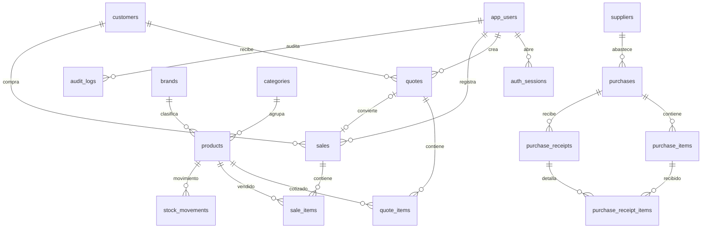

# Modelo de datos SQL — SGRV

Base de datos: PostgreSQL 17+; cambios versionados con Flyway (`backend/src/main/resources/db/migration/V1__schema.sql`).



## Decisiones de integridad

- `products.id` identifica inequívocamente un repuesto. `code` no es único globalmente, porque el documento histórico contiene coincidencias comerciales no verificadas.
- Las líneas de compra, venta y cotización tienen cantidades > 0. Cada producto aparece una vez por documento.
- `products.stock` nunca debe ser negativo (constraint + bloqueo `SELECT ... FOR UPDATE`).
- El registro de compras no aumenta stock; únicamente las recepciones confirmadas crean entradas.
- La venta resta existencias dentro de una transacción; la anulación crea una entrada compensatoria en lugar de borrar ventas confirmadas.
- La cotización conserva un snapshot de precio y producto. Al convertirse, usa esos importes y verifica stock actual.
- Las operaciones financieras confirmadas se conservan por auditoría. Borrado de productos con historial se rechaza por claves foráneas.
- Autenticación por token aleatorio con hash SHA-256 almacenado en `auth_sessions`, vencimiento de 12 h y contraseña BCrypt.
- `app_settings` documenta integraciones de facturación electrónica no implementadas; no genera documentos fiscales.
- IGV fijo 18 % para el alcance inicial. Al sumar descuentos se calcula primero el importe descontado y luego IGV.

## Ajustes necesarios antes de producción

Confirmar con Mundo Volvo moneda base (este prototipo operativo supone PEN), tratamiento de productos cotizados con precio variable, los permisos comerciales, inventario por almacenes si aplica, política de devoluciones, factura electrónica y migración de inventario físico verificado.

## Respaldo

```bash
docker compose exec -T db pg_dump -U sgrv sgrv > sgrv_backup.sql
```
Restaurar únicamente en un entorno controlado, tras verificar compatibilidad y realizar copias de seguridad previas.
